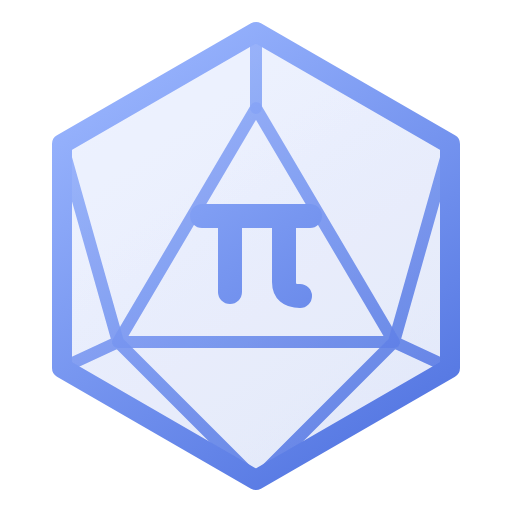

<p align="center"></p>

<h1 align="center">Rolepi</h1>

<p align="center">Конструктор настольных ролевых игр: создайте собственную систему правил, карточки и кампанию — и проведите по ним бой.<br>Модуль лаунчера <b>Asteia Alltools</b>, работает и сам по себе. Windows, macOS, Linux. Русский и английский.</p>

> Раньше проект назывался «MyRolePi OS». Технические идентификаторы остались прежними (id модуля `myrolepi-os`, репозиторий `myrolepi_os`), чтобы не ломать лаунчер и сохранённые данные.

## Что умеет

- **Игровые системы.** Любые типы объектов (персонаж, корабль, город, база, существо…), параметры, формулы, макросы, кубики (`4d6kh3`, взрывные, Fudge).
- **Карточки.** Конструктор на сетке: блоки перетаскиваются и растягиваются, у типа несколько видов карточки, фон-цвет или картинка, пять оформлений.
- **Действия.** Атаки, проверки, лечение: формулы с вопросами при броске и эффектами; журнал бросков.
- **Кампании.** Герои и существа (лист или карточка), галерея и бестиарий, трекер боя (инициатива, раунды, здоровье), заметки мастера со связями и поиском.
- **Плагины.** Свои функции формул, блоки карточек, темы, готовые системы, переводы, команды и пресеты кубиков, настройки. Плагин работает только после вашего разрешения. Страница «Плагины» создаёт шаблон и готовит запрос для нейросети — [руководство для нейросети](docs/AI_PLUGIN_GUIDE.md) ([English](docs/AI_PLUGIN_GUIDE.en.md), [типы API](docs/plugin-api.d.ts)).
- **Удобство.** Палитра команд `Ctrl+K`, справочник с поиском, шесть тем оформления, импорт и экспорт JSON, отмена и повтор.

## Запуск

```
npm install
npm run dev          # разработка (Vite + Electron)
npm run build && npm start
```

Из лаунчера: `--launcher --data-dir <путь> --plugins-dir <путь> --lang ru` (см. `asteia.module.json`). Лаунчер ещё минимальный (`launcher/`) — формат модуля задаёт это приложение.

## Проверки

```
npm run typecheck    # типы
npm test             # юнит-тесты: ядро, плагины, санитайзер, примеры из гайда
npm run e2e          # сценарии в браузере (нужен Chromium; путь — переменная CHROME_PATH)
npm run e2e:electron # настоящий Electron под xvfb (Linux)
```

## Платформы, сборка и обновления

Windows (установщик + portable), macOS (dmg и zip, x64/arm64), Linux (AppImage): `npm run dist:win | dist:mac | dist:linux`
(кросс-сборка не гарантируется — собирайте на целевой ОС или в CI). Релиз по тегу: `git tag v0.3.0 && git push origin v0.3.0` — GitHub Actions прогонит проверки, соберёт все системы и возьмёт описание релиза из `CHANGELOG.md`. **Релиз вручную не создавайте** — сборка сама его создаст.

- **Приложение никогда не обновляется само и не ходит в сеть за обновлениями.** Хотите обновления — используйте лаунчер Asteia Alltools; не хотите — скачайте нужную версию вручную из GitHub Releases и оставайтесь на ней.
- **Лаунчер** читает фид `UpdateFeed` (`src/core/updates.ts`), ставит обновления и показывает changelog. Changelog также лежит в приложении (раздел «О программе»).

## Лаунчер (`launcher/`)
Минимальный лаунчер Asteia Alltools: список модулей (`launcher/modules.json`), выбор любой версии из GitHub Releases, установка, запуск, переключение и удаление версий, changelog из описания релиза. Запуск из исходников: `cd launcher && npm install && npm start`. Готовые сборки: тег `lan-v0.0.1` (workflow `launcher.yml`) → Releases.
Файлы релиза выбираются автоматически: Windows — `*-portable.exe` или установщик `*Setup*.exe` (ставится тихо в каталог версии), Linux — `*.AppImage`, macOS — `*.zip` или `*.dmg`.

## Структура
- `src/core` — движок без привязки к интерфейсу: кубики, формулы, схема системы, вычисление параметров, действия и инициатива, проверка, i18n, контракт плагинов.
- `src/main` — Electron: окно, хранилище JSON и файлов, резервные копии, ключ автора, загрузка плагинов и протоколы `rolepi-asset://` и `rolepi-plugin://` (панели).
- `src/renderer` — интерфейс (React): студия, карточки, плагины, справочник, палитра команд, темы.
- `panel-sdk/` — `@sdk.js` и `@sdk.css`, которые подключают страницы панелей плагинов.
- `docs/` — руководство для нейросети (RU/EN), типы API, заметки для разработчиков; `examples/` — пример системы «Космическая опера»; `plugins/` — примеры плагинов; `e2e/` — сценарные проверки.

Заметки для разработчиков и ограничения: [docs/DEVELOPMENT_HANDOFF.md](docs/DEVELOPMENT_HANDOFF.md). История версий: [CHANGELOG.md](CHANGELOG.md).
